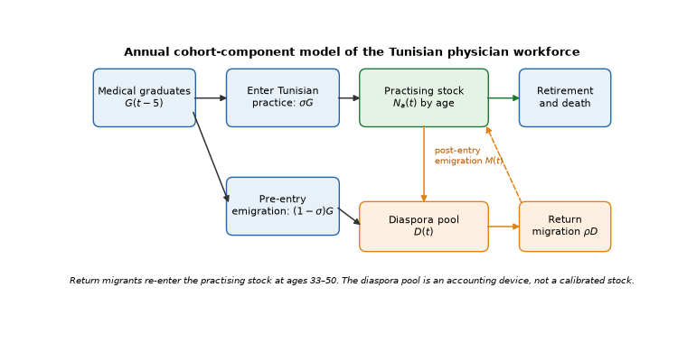

# Additional file 1

## Supplementary tables for: Retention, return or training? A stock-and-flow simulation of Tunisia's physician workforce under incomplete migration data

### Table S1. Model notation

| Symbol | Definition |
|---|---|
| N_a(t) | Practising physicians aged a at the end of year t |
| D(t) | Return-eligible pool of Tunisian-trained physicians abroad |
| G(t) | Medical graduates in year t |
| σ(t) | Share of graduates entering Tunisian practice |
| E(t) | Entrants to the practising stock |
| X(t) | Pre-entry emigration (graduates who never enter Tunisian practice) |
| M(t) | Post-entry emigration flow |
| m(t) | Calibrated baseline post-entry emigration flow |
| Π(t) | Scenario multiplier on post-entry emigration |
| ε | Projection-only shock to future emigration intensity |
| ρ(t) | Annual return rate from the return-eligible pool |
| δ | Annual attrition from the return-eligible pool (death abroad, onward migration, settlement) |
| R(t) | Return migrants entering the practising stock |
| r_a | Age-specific retirement hazard |
| q_a | Age-specific mortality hazard |
| w_a | Relative age profile of emigration |
| L | Postgraduate training lag (5 years) |

### Figure S1. Model flow diagram

### Table S2. Assumed relative age profile of emigration

| Age group | Relative weight w_a |
|---|---|
| 25–29 | 0.85 |
| 30–34 | 1.00 |
| 35–39 | 0.60 |
| 40–44 | 0.35 |
| 45–49 | 0.20 |
| 50–54 | 0.10 |
| 55–59 | 0.04 |
| 60–64 | 0.02 |
| 65+ | 0.01 |

Weights are relative, not rates. The absolute number of emigrants is set by the calibrated flow M(t). The profile is varied in sensitivity analysis through a tilt parameter (lognormal, median 1.0, log-SD 0.15).

### Table S3. Scenario effect sizes: low, central and high

| Scenario | Post-entry emigration multiplier (low / central / high) | Reduction in pre-entry emigration (low / central / high) | Return-rate multiplier (low / central / high) | Training multiplier (low / central / high) |
|---|---|---|---|---|
| Business as usual | 1.00 / 1.00 / 1.00 | 0 / 0 / 0 | 1.00 / 1.00 / 1.00 | 1.00 / 1.00 / 1.00 |
| Remuneration and conditions | 0.85 / 0.70 / 0.55 | 15% / 30% / 45% | 1.00 / 1.00 / 1.00 | 1.00 / 1.00 / 1.00 |
| Career development | 0.92 / 0.85 / 0.75 | 8% / 15% / 25% | 1.00 / 1.00 / 1.00 | 1.00 / 1.00 / 1.00 |
| Return migration | 1.00 / 1.00 / 1.00 | 0 / 0 / 0 | 1.35 / 1.75 / 2.50 | 1.00 / 1.00 / 1.00 |
| Training expansion | 1.00 / 1.00 / 1.00 | 0 / 0 / 0 | 1.00 / 1.00 / 1.00 | 1.15 / 1.30 / 1.50 |
| Combined strategy | 0.78 / 0.65 / 0.55 | 22% / 35% / 45% | 1.35 / 1.75 / 2.50 | 1.00 / 1.00 / 1.00 |

### Table S4. Parameter distributions for the Monte Carlo analysis

| Parameter | Distribution | Mean / median | Dispersion | Truncation |
|---|---|---|---|---|
| Pipeline retention, σ | Beta | 0.55 | SD 0.12 | 0.30–0.80 |
| Training-output multiplier | Lognormal | 1.00 | log-SD 0.20 | 0.85–1.50 |
| Return rate, ρ | Beta | 0.020 | SD 0.010 | 0.005–0.050 |
| Diaspora attrition, δ | Uniform | 0.095 | Range 0.04–0.15 | 0.04–0.15 |
| Return retention | Uniform | 0.85 | Range 0.75–0.95 | 0.75–0.95 |
| Emigration age tilt | Lognormal | 1.00 | log-SD 0.15 | 0.60–1.60 |
| Retirement-age shift | Uniform | 0 | ±1.5 years | −1.5 to +1.5 |
| Initial stock, 2008 | Normal | 12 600 | SD 400 | 11 300–13 900 |
| Projection-only emigration shock, ε | Lognormal | 1.00 | log-SD 0.10 | 0.70–1.40 |

For each draw, the post-entry emigration flow m is recalibrated to the observed 2024 stock before the projection. All scenarios use the same draw (common random numbers), so scenario differences are not confounded with parameter draws. The maximum absolute calibration error across 2 000 accepted draws is 0.14 physicians.

### Table S5. Full scenario results: deterministic central estimates and Monte Carlo intervals

| Scenario | Workforce 2040, deterministic | Workforce 2040, median (90% interval) | Physician-years vs BAU, median (90% interval) |
|---|---|---|---|
| Business as usual | 16 019 | 15 933 (14 514–17 565) | — |
| Remuneration and conditions | 19 504 | 19 755 (18 089–22 367) | 29 839 (21 086–43 385) |
| Career development | 17 760 | 17 838 (16 405–19 839) | 14 912 (10 539–21 677) |
| Return migration | 17 320 | 17 155 (15 622–19 790) | 9 243 (3 455–22 536) |
| Training expansion | 17 131 | 17 087 (15 588–19 032) | 3 520 (2 364–5 023) |
| Combined strategy | 21 125 | 21 454 (19 347–25 172) | 43 113 (28 908–66 190) |

The deterministic and median columns differ because the deterministic column uses the central calibration and the median column is the median of 2 000 calibrated draws. The combined interval is wider in absolute terms than the return interval; the return interval is wider than the other single-policy intervals.

### Table S6. Identifiability grid (selected values)

| Pipeline retention σ | Training multiplier | RMSE (physicians) | Implied total emigration, 2024 | Return-eligible pool, 2024 |
|---|---|---|---|---|
| 0.30 | 0.85 | Infeasible | — | — |
| 0.30 | 1.00 | Infeasible | — | — |
| 0.30 | 1.20 | 244 | 1 028 | 7 843 |
| 0.30 | 1.50 | 252 | 1 427 | 10 454 |
| 0.40 | 0.85 | 240 | 589 | 4 842 |
| 0.40 | 1.00 | 246 | 793 | 6 155 |
| 0.40 | 1.20 | 257 | 1 066 | 7 906 |
| 0.40 | 1.50 | 276 | 1 474 | 10 529 |
| 0.50 | 0.85 | 251 | 616 | 4 887 |
| 0.50 | 1.00 | 264 | 825 | 6 207 |
| 0.50 | 1.20 | 283 | 1 103 | 7 966 |
| 0.50 | 1.50 | 319 | 1 520 | 10 603 |
| 0.55 | 0.85 | 260 | 629 | 4 909 |
| 0.55 | 1.00 | 276 | 841 | 6 234 |
| 0.55 | 1.20 | 301 | 1 122 | 7 996 |
| 0.55 | 1.50 | 346 | 1 543 | 10 639 |
| 0.60 | 0.85 | 270 | 643 | 4 931 |
| 0.60 | 1.00 | 290 | 856 | 6 258 |
| 0.60 | 1.20 | 321 | 1 140 | 8 025 |
| 0.60 | 1.50 | 375 | 1 566 | 10 674 |
| 0.70 | 0.85 | 294 | 669 | 4 974 |
| 0.70 | 1.00 | 323 | 887 | 6 307 |
| 0.70 | 1.20 | 366 | 1 177 | 8 083 |
| 0.70 | 1.50 | 440 | 1 612 | 10 744 |
| 0.80 | 0.85 | 322 | 696 | 5 016 |
| 0.80 | 1.00 | 361 | 918 | 6 355 |
| 0.80 | 1.20 | 418 | 1 214 | 8 139 |
| 0.80 | 1.50 | 511 | 1 657 | 10 812 |

The full grid is available in `outputs/tables/identifiability_grid.csv`. The grid is a two-dimensional slice conditional on the return rate, initial stock, retirement age and age profile. "Infeasible" means the combination cannot reproduce the 2024 stock even with zero post-entry emigration. The acceptable-fit set (RMSE ≤302) implies 582–1 497 annual emigrants; the strict set (RMSE ≤262) implies 582–1 450; the destination-consistent subset (pool 4 000–10 000) implies 582–1 405.

### Table S7. Structural scenarios: annual growth in emigration intensity

| Margin | Annual growth | Workforce 2030 | Workforce 2040 | Density 2040 (/1 000) | Cumulative emigration 2026–2040 | Remuneration 2040 | Career 2040 | Return 2040 | Training 2040 | Combined 2040 |
|---|---|---|---|---|---|---|---|---|---|---|
| Post-entry only | 0% | 15 595 | 16 019 | 1.27 | 13 887 | 19 504 | 17 760 | 17 320 | 17 131 | 21 125 |
| Post-entry only | 3% | 15 375 | 14 520 | 1.15 | 15 540 | 18 443 | 16 479 | 15 901 | 15 632 | 20 190 |
| Post-entry only | 5% | 15 215 | 13 230 | 1.05 | 16 958 | 17 531 | 15 377 | 14 676 | 14 341 | 19 385 |
| Post-entry only | 7% | 15 044 | 11 643 | 0.92 | 18 698 | 16 409 | 14 022 | 13 167 | 12 753 | 18 393 |
| Both margins | 0% | 15 595 | 16 019 | 1.27 | 13 887 | 19 504 | 17 760 | 17 320 | 17 131 | 21 125 |
| Both margins | 3% | 15 017 | 11 969 | 0.95 | 18 305 | 16 638 | 14 300 | 13 483 | 12 648 | 18 599 |
| Both margins | 5% | 14 598 | 8 563 | 0.68 | 22 033 | 14 177 | 11 329 | 10 226 | 8 851 | 16 424 |
| Both margins | 7% | 14 150 | 6 034 | 0.48 | 24 915 | 11 158 | 8 160 | 7 668 | 6 215 | 13 751 |

All values are deterministic central-calibration projections. The post-entry-only and both-margin scenarios are different assumptions about which emigration margin is trended; they are not uncertainty intervals.

### Table S8. Break-even grid (selected values): workforce in 2040

| Training expansion | Retention 0% | Retention 10% | Retention 20% | Retention 30% | Retention 40% | Retention 50% |
|---|---|---|---|---|---|---|
| 0% | 16 019 | 17 184 | 18 346 | 19 504 | 20 673 | 21 838 |
| 30% | 17 131 | 18 380 | 19 626 | 20 873 | 22 121 | 23 370 |
| 60% | 18 249 | 19 576 | 20 906 | 22 237 | 23 569 | 24 902 |
| 94% | 19 504 | 20 932 | 22 357 | 23 783 | 25 210 | 26 638 |
| 100% | 19 732 | 21 172 | 22 613 | 24 056 | 25 500 | 26 945 |

The full grid is available in `outputs/tables/breakeven_grid.csv`. A 9.6% reduction in emigration matches a 30% training expansion; a 94% training expansion is needed to match a 30% retention effect.

### Table S9. Diaspora sensitivity (selected values, initial pool 4 000)

| Diaspora attrition δ | Return rate ρ | Pool 2024 | BAU 2040 | Return scenario 2040 | Return advantage 2040 | Eventual return probability |
|---|---|---|---|---|---|---|
| 0.02 | 0.005 | 11 147 | 16 414 | 17 086 | 672 | 0.20 |
| 0.02 | 0.020 | 11 135 | 16 977 | 19 338 | 2 361 | 0.50 |
| 0.02 | 0.040 | 11 122 | 17 611 | 21 620 | 4 009 | 0.67 |
| 0.08 | 0.005 | 6 222 | 16 154 | 16 506 | 352 | 0.06 |
| 0.08 | 0.020 | 6 234 | 16 019 | 17 320 | 1 301 | 0.20 |
| 0.08 | 0.040 | 6 250 | 15 881 | 18 232 | 2 350 | 0.33 |
| 0.15 | 0.005 | 3 576 | 16 097 | 16 309 | 212 | 0.03 |
| 0.15 | 0.020 | 3 610 | 15 800 | 16 611 | 811 | 0.12 |
| 0.15 | 0.040 | 3 653 | 15 461 | 16 993 | 1 531 | 0.21 |

The full sensitivity over initial pool 2 000–8 000 is in `outputs/tables/diaspora_sensitivity.csv`. The return advantage ranges from 210 to 4 756 physicians; the 2024 pool ranges from 3 441 to 13 986; the eventual return probability ranges from 0.03 to 0.67.

### Table S10. Alternative graduate-output baselines

| Graduate path | Graduates 2040 | BAU 2040 | Training 2040 | Combined 2040 | Training physician-years | Combined physician-years |
|---|---|---|---|---|---|---|
| Baseline, constant 1 305 | 1 305 | 16 019 | 17 131 | 21 125 | 3 316 | 39 692 |
| Continued 1.7% growth | 1 709 | 16 907 | 18 201 | 22 261 | 3 817 | 40 742 |
| Constant 1 900 | 1 900 | 19 807 | 21 427 | 25 965 | 4 829 | 45 970 |

The 1 900 figure is an upper-bound ministerial statement, not a baseline. The ranking of policies is unchanged across the three paths.

### Table S11. Illustrative resource costs, 2026–2040

| Scenario | Total cost (TND million) | Cost per physician-year (TND) | Low unit costs | High unit costs | Cost per additional physician in 2040 (TND) |
|---|---|---|---|---|---|
| Remuneration and conditions | 2 269 | 84 500 | 42 200 | 169 000 | 651 000 |
| Career development | 749 | 55 800 | 27 900 | 111 700 | 431 000 |
| Return migration | 53 | 5 400 | 2 700 | 10 800 | 41 000 |
| Training expansion | 979 | 295 200 | 147 600 | 590 300 | 880 000 |
| Combined strategy | 2 803 | 70 600 | 35 300 | 141 300 | 549 000 |

Assumptions: 30% increment on an average public-sector compensation of TND 72 000 per physician-year; TND 3 000 per practising physician-year for career development; TND 250 000 per additional graduate; TND 40 000 per additional return migrant. Costs are undiscounted 2025 TND and exclude infrastructure, demand-side costs and health gains. Wages are transfers, not resource costs. Low and high columns multiply all unit costs by 0.5 and 2.0.

### Table S12. Validation checks

| Check | Result | Value |
|---|---|---|
| 2024 calibration exact | Pass | Error 0.04 physicians |
| Monte Carlo calibration exact | Pass | Maximum absolute error 0.14 physicians |
| Flow identity holds | Pass | Entries − post-entry emigration + returns − retirements − deaths = stock change |
| Combined ranks first in deterministic 2040 | Pass | 21 125 vs next highest 19 504 |
| Identifiability range non-empty | Pass | 582–1 497 |
| True PRCC for future emigration is negative | Pass | −0.84 |
| All scenarios positive | Pass | Minimum 2040 stock 16 019 (BAU) |
| Scenarios use common random numbers | Pass | Same 2 000 draws for all scenarios |

### Table S13. Good practice reporting checklist (30 items)

The checklist follows the Good Practice Reporting Guideline for Health Workforce Models of Lee et al. (Human Resources for Health 2024;22:25). Items that do not apply to a supply-only model are marked NA with a reason.

| Item | Guideline requirement | Where addressed | Status |
|---|---|---|---|
| 1 | Identify the study as health workforce planning and specify the professionals | Title; Background | Reported |
| 2 | Structured abstract with context, methods, results and alternative analyses | Abstract | Reported |
| 3 | Context, aims and practical relevance | Background; last paragraph | Reported |
| 4 | Study population characteristics | Methods, "Definitions and data"; Table 1 | Reported |
| 5 | Geographical area and level | Methods; Title | Reported (national) |
| 6 | Whether a specific health condition is the focus | Methods, "Design" | Reported (none; workforce supply) |
| 7 | Health professionals covered | Title; Methods | Reported (physicians) |
| 8 | Time horizon | Methods, "Design" | Reported (2008–2040; projection 2024–2040) |
| 9 | Scope of activities (healthcare, aged care, disability, community) | Methods, "Design" | Reported (healthcare only) |
| 10 | Overall analytical framework | Methods, "Model structure"; Figure S1 | Reported |
| 11 | Parameters and variables, and how estimated | Methods; Table 2; Table S4 | Reported |
| 12 | Demand-side model and statistical approach | — | NA: supply-only model; demand is outside scope |
| 13 | Supply-side model and statistical approach | Methods, "Model structure" | Reported |
| 14 | Gap analysis methodology | — | NA: no demand projection, so no supply–demand gap |
| 15 | Budgetary analysis methodology | Methods, "Illustrative costs"; Table 6 | Partially reported: illustrative cost per physician-year, not a fiscal budget model |
| 16 | Characterising uncertainty | Methods, "Uncertainty and sensitivity"; Table S4 | Reported |
| 17 | Key assumptions and justification | Methods; Table 2; "Strengths and limitations" | Reported |
| 18 | Methods for validation and scenario parameter derivation | Methods; Table S12 | Reported (internal consistency and hindcast; no external validation) |
| 19 | Data sources, quality and relevance | Table 1; Additional file 1 | Reported |
| 20 | Summary of projection results for each profession | Results; Table 5; Table S5 | Reported |
| 21 | Projections for geographical areas | — | NA: national model; no subnational projection |
| 22 | Supply–demand gap over time | — | NA: no demand model |
| 23 | Geographical distribution | — | NA: no regional disaggregation |
| 24 | Effects of policies and scenarios, including financial impact | Results, "Policy scenarios"; Table 5; Table 6 | Reported (supply effects and illustrative costs) |
| 25 | Effects of uncertainty and sensitivity | Results, "Sensitivity"; Fig. 6; Table S5 | Reported |
| 26 | Model validation and robustness | Results, "Structural uncertainty"; Table 7; Table S12 | Reported (internal robustness; no external validation) |
| 27 | Key findings, implications and limitations | Discussion | Reported |
| 28 | Policy recommendations on planning, education, training, recruitment and retention | Discussion, "Policy implications" | Reported |
| 29 | Source of funding | Declarations | Reported |
| 30 | Conflicts of interest | Declarations | Reported |

Number formatting in this file uses spaces as thousands separators, matching the main text.
