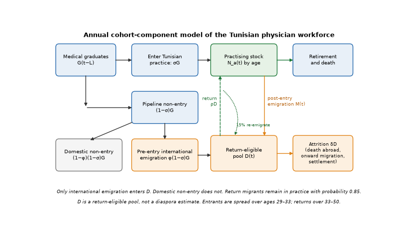
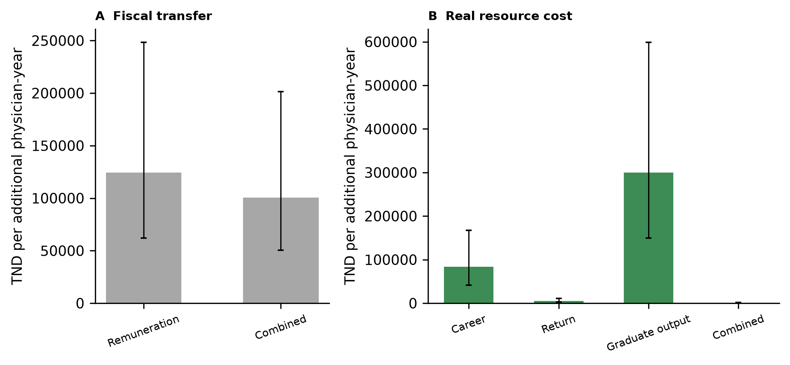

# Additional file 1

## Supplementary tables for: Retention, return or training? A stock-and-flow simulation of Tunisia's physician workforce under incomplete migration data

### Table S1. Model notation

| Symbol | Definition |
|---|---|
| N_a(t) | Practising physicians aged a at the end of year t |
| D(t) | Return-eligible pool of Tunisian-trained physicians abroad |
| G(t) | Medical graduates in year t |
| σ(t) | Share of graduates entering Tunisian practice |
| φ(t) | Share of pipeline non-entry assumed to be international emigration |
| X_pre(t) | Pre-entry international emigration: φ(1−σ)G |
| X_dom(t) | Domestic non-entry: (1−φ)(1−σ)G |
| E(t) | Entrants to the practising stock |
| M(t) | Post-entry emigration flow |
| m(t) | Calibrated baseline post-entry emigration flow |
| Π(t) | Scenario multiplier on post-entry emigration |
| ε | Projection-only shock to future emigration intensity |
| ρ(t) | Annual return-attempt rate from the return-eligible pool |
| θ | Share of return attempts that remain in practice (0.85) |
| δ | Annual attrition from the return-eligible pool (death abroad, onward migration, settlement) |
| R(t) | Successful return migrants entering the practising stock |
| return_recycling | Whether unsuccessful return attempts rejoin the pool (central true) |
| r_a | Age-specific retirement hazard |
| q_a | Age-specific mortality hazard |
| w_a | Relative age profile of emigration |
| L | Postgraduate training lag (central 5 years) |

Under the central recycling specification, the implemented annual pool transition is D(t+1) = [D(t) + X_pre(t) + M(t)](1−θρ)(1−δ). Gross return attempts are ρD after current-year inflows; θρD succeed and enter R(t), (1−θ)ρD rejoin D immediately, and δ is applied to the surviving pool. The net return-related reduction is therefore θρD, not a second subtraction of successful returns. Under no recycling, failed attempts leave permanently and the pool transition is D(t+1) = [D(t) + X_pre(t) + M(t)](1−ρ)(1−δ).

### Figure S1. Model flow diagram

Pipeline non-entry is split into pre-entry international emigration and domestic non-entry. Only international emigration enters the return-eligible pool. Return attempts occur at rate ρD; 85% succeed and 15% re-emigrate; under central recycling, failed attempts rejoin the pool. The diagram is illustrative, not to scale.

### Figure S2. Exploratory fiscal and resource cost ratios, 2026–2040

(A) Fiscal transfers and (B) real resource costs per additional physician-year relative to business as usual, with 0.5–2.0× unit-cost error bars. The panels are separate and are not stacked or summed. The categories are not commensurable and this is not a cost-effectiveness or budget-impact analysis.

### Table S2. Assumed relative age profile of emigration

| Age group | Relative weight w_a |
|---|---|
| 25–29 | 0.85 |
| 30–34 | 1.00 |
| 35–39 | 0.60 |
| 40–44 | 0.35 |
| 45–49 | 0.20 |
| 50–54 | 0.10 |
| 55–59 | 0.04 |
| 60–64 | 0.02 |
| 65+ | 0.01 |

Weights are relative, not rates. The absolute number of emigrants is set by the calibrated flow. The profile is varied in sensitivity analysis through a lognormal tilt (median 1.0, log-SD 0.15).

### Table S3. Scenario effect sizes: low, central and high

| Scenario | Post-entry emigration multiplier (low / central / high) | Reduction in pre-entry international emigration (low / central / high) | Return-rate multiplier (low / central / high) | Training multiplier (low / central / high) |
|---|---|---|---|---|
| Business as usual | 1.00 / 1.00 / 1.00 | 0 / 0 / 0 | 1.00 / 1.00 / 1.00 | 1.00 / 1.00 / 1.00 |
| Remuneration and conditions | 0.85 / 0.70 / 0.55 | 15% / 30% / 45% | 1.00 / 1.00 / 1.00 | 1.00 / 1.00 / 1.00 |
| Career development | 0.92 / 0.85 / 0.75 | 8% / 15% / 25% | 1.00 / 1.00 / 1.00 | 1.00 / 1.00 / 1.00 |
| Return migration | 1.00 / 1.00 / 1.00 | 0 / 0 / 0 | 1.35 / 1.75 / 2.50 | 1.00 / 1.00 / 1.00 |
| Hypothetical graduate-output expansion | 1.00 / 1.00 / 1.00 | 0 / 0 / 0 | 1.00 / 1.00 / 1.00 | 1.15 / 1.30 / 1.50 |
| Combined strategy | 0.78 / 0.65 / 0.55 | 22% / 35% / 45% | 1.35 / 1.75 / 2.50 | 1.00 / 1.00 / 1.00 |

Pre-entry reductions apply to the φ share of pipeline non-entry, not to all non-entry.

### Table S4. Parameter distributions for the Monte Carlo analysis

| Parameter | Distribution | Mean / median | Dispersion | Truncation |
|---|---|---|---|---|
| Pipeline retention, σ | Beta | 0.55 | SD 0.12 | 0.30–0.80 |
| Share of non-entry that is emigration, φ | Uniform | 0.50 | Range 0.25–0.75 | 0.25–0.75 |
| Training-output multiplier | Lognormal | 1.00 | log-SD 0.20 | 0.85–1.50 |
| Return rate, ρ | Beta | 0.020 | SD 0.010 | 0.005–0.050 |
| Diaspora attrition, δ | Uniform | 0.080 | Range 0.04–0.12 | 0.04–0.12 |
| Return retention | Uniform | 0.85 | Range 0.75–0.95 | 0.75–0.95 |
| Emigration age tilt | Lognormal | 1.00 | log-SD 0.15 | 0.60–1.60 |
| Retirement-age shift | Uniform | 0 | ±1.5 years | −1.5 to +1.5 |
| Initial stock, 2008 | Normal | 12 600 | SD 400 | 11 300–13 900 |
| Initial return-eligible pool, 2008 | Lognormal | 4 000 | log-SD 0.30 | 2 000–8 000 |
| Mortality multiplier | Uniform | 1.00 | Range 0.8–1.2 | 0.8–1.2 |
| Projection-only emigration shock, ε | Lognormal | 1.00 | log-SD 0.10 | 0.70–1.40 |

For each draw, the post-entry emigration flow m is recalibrated to the observed 2024 stock before the projection. All scenarios use the same draw (common random numbers). The maximum absolute calibration error across 4 000 accepted draws is 0.14 physicians.

### Table S5. Full scenario results: deterministic central estimates and Monte Carlo intervals

| Scenario | Workforce 2040, deterministic | Workforce 2040, median (90% interval) | Physician-years vs BAU, median (90% interval) |
|---|---|---|---|
| Business as usual | 15 821 | 15 830 (14 407–17 438) | — |
| Remuneration and conditions | 18 087 | 18 403 (16 522–20 838) | 19 774 (10 598–32 722) |
| Career development | 16 953 | 17 115 (15 586–19 043) | 9 883 (5 298–16 352) |
| Return migration | 16 689 | 16 749 (15 354–18 877) | 6 862 (2 490–16 448) |
| Hypothetical graduate-output expansion | 16 914 | 16 980 (15 425–18 878) | 3 480 (2 384–5 025) |
| Combined strategy | 19 162 | 19 577 (17 328–22 784) | 29 150 (15 264–49 291) |

Deterministic and median columns differ because the deterministic column uses the central calibration and the median column is the median of 4 000 calibrated draws. The deterministic and Monte Carlo physician-years must not be mixed.

### Table S6. Identifiability grid (selected values)

| Pipeline retention σ | Training multiplier | RMSE (physicians) | Pipeline non-entry 2024 | International emigration 2024 (φ=0.50) | Upper bound (φ=1) | Return-eligible pool 2024 |
|---|---|---|---|---|---|---|
| 0.20 | 1.60 | 239 | 1 396 | 718 | 1 416 | 5 771 |
| 0.30 | 1.20 | 243 | 916 | 509 | 967 | 4 255 |
| 0.30 | 1.50 | 255 | 1 146 | 778 | 1 351 | 5 969 |
| 0.40 | 1.00 | 250 | 655 | 423 | 750 | 3 593 |
| 0.40 | 1.20 | 263 | 785 | 621 | 1 014 | 4 831 |
| 0.50 | 0.80 | 251 | 436 | 299 | 517 | 2 738 |
| 0.50 | 1.00 | 271 | 545 | 516 | 789 | 4 072 |
| 0.50 | 1.20 | 295 | 655 | 732 | 1 060 | 5 405 |
| 0.55 | 0.85 | 265 | 417 | 393 | 602 | 3 276 |
| 0.55 | 1.00 | 284 | 491 | 563 | 808 | 4 312 |
| 0.55 | 1.20 | 313 | 589 | 788 | 1 083 | 5 691 |
| 0.60 | 1.00 | 299 | 436 | 609 | 827 | 4 550 |
| 0.70 | 0.80 | 290 | 262 | 448 | 579 | 3 505 |
| 0.70 | 1.00 | 332 | 327 | 702 | 866 | 5 027 |
| 0.80 | 1.00 | 369 | 218 | 795 | 904 | 5 503 |
| 0.80 | 1.50 | 525 | 327 | 1 473 | 1 636 | 9 533 |

The full grid is in `outputs/tables/identifiability_grid.csv`. Infeasible low-σ/low-training combinations are omitted. The acceptable-fit set (RMSE ≤302) spans σ = 0.20–0.72 and training 0.80–1.60; because the best fit lies on the grid boundary, the true range may extend beyond it. Under φ = 0.50 the acceptable set implies 262–1 017 international emigrants; the upper bound (φ = 1) is 502–1 540. The destination-consistent subset (pool 4 000–10 000) implies 481–1 017 and 705–1 540, with pools 4 015–7 304. This screen removes low-pool combinations that fit the stock equally well; it is a plausibility check, not identification.

### Table S7. Structural scenarios: annual growth in emigration intensity

| Margin | Annual growth | Workforce 2030 | Workforce 2040 | Density 2040 (/1 000) | Cumulative emigration 2026–2040 | Remuneration 2040 | Career 2040 | Return 2040 | Training 2040 | Combined 2040 |
|---|---|---|---|---|---|---|---|---|---|---|
| Post-entry only | 0% | 15 547 | 15 821 | 1.25 | 9 079 | 18 087 | 16 953 | 16 689 | 16 914 | 19 162 |
| Post-entry only | 3% | 15 347 | 14 461 | 1.14 | 10 580 | 17 125 | 15 792 | 15 401 | 15 553 | 18 315 |
| Post-entry only | 5% | 15 202 | 13 289 | 1.05 | 11 867 | 16 298 | 14 792 | 14 290 | 14 381 | 17 585 |
| Post-entry only | 7% | 15 047 | 11 848 | 0.94 | 13 446 | 15 281 | 13 563 | 12 919 | 12 939 | 16 686 |
| Both margins | 0% | 15 547 | 15 821 | 1.25 | 9 079 | 18 087 | 16 953 | 16 689 | 16 914 | 19 162 |
| Both margins | 3% | 15 168 | 13 184 | 1.04 | 11 962 | 16 222 | 14 701 | 14 191 | 14 059 | 17 519 |
| Both margins | 5% | 14 893 | 10 917 | 0.86 | 14 436 | 14 621 | 12 766 | 12 039 | 11 594 | 16 105 |
| Both margins | 7% | 14 600 | 8 216 | 0.65 | 17 394 | 12 653 | 10 390 | 9 426 | 8 609 | 14 364 |

All values are deterministic central-calibration projections. The two margins are different assumptions, not uncertainty intervals. “Both margins” applies the trend to pre-entry international emigration (the φ share) and post-entry emigration.

### Table S8. Break-even grid (selected values): workforce in 2040

| Graduate-output expansion | Retention 0% | Retention 10% | Retention 20% | Retention 30% | Retention 40% | Retention 50% |
|---|---|---|---|---|---|---|
| 0% | 15 821 | 16 576 | 17 331 | 18 087 | 18 844 | 19 601 |
| 30% | 16 914 | 17 710 | 18 508 | 19 306 | 20 104 | 20 904 |
| 62% | 18 079 | 18 920 | 19 763 | 20 605 | 21 449 | 22 293 |
| 94% | 19 244 | 20 131 | 21 018 | 21 905 | 22 794 | 23 682 |
| 100% | 19 463 | 20 358 | 21 253 | 22 149 | 23 046 | 23 943 |

The full grid is in `outputs/tables/breakeven_grid.csv`. A 14.5% reduction in emigration matches a 30% graduate-output expansion; a 62% graduate-output expansion matches a 30% retention effect.

### Table S9. Diaspora sensitivity (selected values, initial pool 4 000)

| Diaspora attrition δ | Return rate ρ | Pool 2024 | BAU 2040 | Return scenario 2040 | Return advantage 2040 | Attempt probability | Successful-return probability | Mean duration (years) |
|---|---|---|---|---|---|---|---|---|
| 0.02 | 0.005 | 8 055 | 16 267 | 16 729 | 463 | 0.201 | 0.176 | 41.4 |
| 0.02 | 0.020 | 8 050 | 16 436 | 18 074 | 1 638 | 0.505 | 0.464 | 27.3 |
| 0.02 | 0.040 | 8 044 | 16 635 | 19 443 | 2 808 | 0.676 | 0.638 | 18.8 |
| 0.08 | 0.005 | 4 288 | 16 101 | 16 333 | 232 | 0.059 | 0.051 | 11.9 |
| 0.08 | 0.020 | 4 312 | 15 821 | 16 689 | 868 | 0.203 | 0.178 | 10.5 |
| 0.08 | 0.040 | 4 342 | 15 519 | 17 109 | 1 590 | 0.342 | 0.306 | 9.0 |
| 0.15 | 0.005 | 2 367 | 16 082 | 16 218 | 137 | 0.032 | 0.028 | 6.5 |
| 0.15 | 0.020 | 2 406 | 15 742 | 16 270 | 529 | 0.120 | 0.103 | 6.1 |
| 0.15 | 0.040 | 2 456 | 15 350 | 16 362 | 1 012 | 0.217 | 0.190 | 5.6 |

The exact discrete-time probabilities under the implemented annual order are: attempt = ρ/[1−(1−ρ)(1−δ)]; successful return = θρ/[1−(1−θρ)(1−δ)]; mean duration = 1/[1−(1−θρ)(1−δ)]. These are competing-risk approximations to the annual transition, not continuous-time limits. The full sensitivity over initial pool 2 000–8 000 is in `outputs/tables/diaspora_sensitivity.csv`. The return advantage ranges from 134 to 3 556 physicians; the 2024 pool ranges from 2 232 to 10 898; successful-return probability ranges from 0.028 to 0.638.

**No-recycling sensitivity (central parameters).** With re-emigrants permanently outside the pool: pool 2024 4 199, successful returns 2024 79, BAU 2040 15 811, return 2040 16 639, return advantage 828, attempt probability 0.203, successful-return probability 0.173, mean duration 10.2 years. The full table is in `outputs/tables/return_accounting_sensitivity.csv`.

### Table S10. Specification sensitivity: lag, age shape, retirement and mortality

| Specification | BAU 2040 | Training 2040 | Combined 2040 | Retention match for 30% training |
|---|---|---|---|---|
| Lag 3 years | 15 705 | 17 239 | 19 229 | 19.3% |
| Lag 4 years | 15 771 | 17 084 | 19 204 | 16.9% |
| Lag 5 years (central) | 15 821 | 16 914 | 19 162 | 14.5% |
| Lag 6 years | 15 859 | 16 731 | 19 105 | 11.9% |
| Lag 7 years | 15 882 | 16 535 | 19 033 | 9.2% |
| Younger initial age shape | 14 961 | 16 053 | 18 586 | 13.3% |
| Older initial age shape | 16 570 | 17 663 | 19 523 | 16.4% |
| Retirement shift −2, mortality ×1 | 15 986 | — | 18 909 | — |
| Retirement shift −1.5, mortality ×1 | 15 968 | — | 18 993 | — |
| Retirement shift 0, mortality ×0.5 | 15 756 | — | 19 174 | — |
| Retirement shift 0, mortality ×1 | 15 821 | — | 19 162 | — |
| Retirement shift 0, mortality ×1.5 | 15 885 | — | 19 150 | — |
| Retirement shift +1.5, mortality ×1 | 15 545 | — | 19 186 | — |
| Retirement shift +2, mortality ×1 | 15 429 | — | 19 169 | — |

The lag is the interval between graduation and entry into practice. The younger and older age shapes shift the reconstructed 2008 distribution by two years. Retirement and mortality are behavioural assumptions, not legal rules. Full results are in `lag_sensitivity.csv`, `age_shape_sensitivity.csv` and `retirement_sensitivity.csv`.

### Table S11. Exploratory fiscal and resource cost ratios, 2026–2040

| Scenario | Fiscal transfer (TND million) | Real resource cost (TND million) | Fiscal transfer per additional physician-year (TND) | Resource cost per additional physician-year (TND) | Additional physicians 2040 |
|---|---|---|---|---|---|
| Remuneration and conditions | 2 177 | 0 | 124 176 | 0 | 2 266 |
| Career development | 0 | 731 | 0 | 83 443 | 1 132 |
| Return migration | 0 | 36 | 0 | 5 346 | 868 |
| Hypothetical graduate-output expansion | 0 | 979 | 0 | 299 443 | 1 092 |
| Combined strategy | 2 626 | 18 | 100 658 | 700 | 3 341 |

Assumptions: 30% increment on an average public-sector compensation of TND 72 000 per physician-year; TND 3 000 per practising physician-year for career development; TND 250 000 per additional graduate; TND 40 000 per additional return migrant. Fiscal transfers are payments; resource costs are training, career-development and return-programme costs. Costs are undiscounted 2025 TND; ratios use physician-years relative to business as usual. They exclude infrastructure, demand-side costs and health gains. Fiscal transfers and resource costs are not commensurable, are reported separately and are not summed. The combined package is costed as a 35% public-sector increment plus return-programme costs; no separate career-development line is added. Unit-cost ranges (0.5–2.0×) are in Fig. S2. This is not a cost-effectiveness, budget-impact or value-for-money analysis.

### Table S12. Validation checks

| Check | Result | Value |
|---|---|---|
| 2024 calibration exact | Pass | Error −0.10 physicians |
| Monte Carlo calibration exact | Pass | Maximum absolute error 0.14 physicians |
| Workforce flow identity holds for all scenarios | Pass | Entries − post-entry emigration + returns − retirements − deaths = stock change |
| Graduate pipeline identity holds for all scenarios | Pass | Entries + pipeline non-entry = graduate cohort |
| Age distributions non-negative | Pass | — |
| Density calculation consistent | Pass | — |
| Physician-year calculation consistent | Pass | — |
| Emigration hazard cap does not bind | Pass | Maximum simulated hazard 0.057 |
| Hazards in [0, 1] | Pass | — |
| Monte Carlo intervals ordered | Pass | — |
| PRCCs within [−1, 1] | Pass | — |
| Return flow components additive | Pass | Gross = successful + re-emigration |
| Return retention matches flow | Pass | 0.85 |
| Return probabilities ordered | Pass | success 0.178 < attempt 0.203 < 1 |
| No-recycling flow identity | Pass | — |

These checks establish numerical consistency, not external validity.

### Table S13. Good practice reporting checklist (30 items)

The checklist follows the Good Practice Reporting Guideline for Health Workforce Models of Lee et al. (Human Resources for Health 2024;22:25). Items that do not apply to a supply-only model are marked NA with a reason.

| Item | Guideline requirement | Where addressed | Status |
|---|---|---|---|
| 1 | Identify the study as health workforce planning and specify the professionals | Title; Background | Reported |
| 2 | Structured abstract with context, methods, results and alternative analyses | Abstract | Reported |
| 3 | Context, aims and practical relevance | Background | Reported |
| 4 | Study population characteristics | Methods, “Definitions and data”; Table 1 | Reported |
| 5 | Geographical area and level | Methods; Title | Reported (national) |
| 6 | Whether a specific health condition is the focus | Methods, “Design” | Reported (none; workforce supply) |
| 7 | Health professionals covered | Title; Methods | Reported (physicians) |
| 8 | Time horizon | Methods, “Design” | Reported (2008–2040; projection 2024–2040) |
| 9 | Scope of activities | Methods, “Design” | Reported (healthcare only) |
| 10 | Overall analytical framework | Methods, “Model structure”; Figure S1 | Reported |
| 11 | Parameters and variables, and how estimated | Methods; Table 2; Table S4 | Reported |
| 12 | Demand-side model and statistical approach | — | NA: supply-only model |
| 13 | Supply-side model and statistical approach | Methods, “Model structure” | Reported |
| 14 | Gap analysis methodology | — | NA: no demand projection |
| 15 | Budgetary analysis methodology | Methods, “Illustrative costs”; Table 6 | Partially reported: illustrative fiscal/resource cost, not a budget model |
| 16 | Characterising uncertainty | Methods, “Uncertainty and sensitivity”; Table S4 | Reported |
| 17 | Key assumptions and justification | Methods; Table 2; “Strengths and limitations” | Reported |
| 18 | Methods for validation and scenario parameter derivation | Methods; Table S12 | Reported (internal consistency and hindcast; no external validation) |
| 19 | Data sources, quality and relevance | Table 1; Additional file 1 | Reported |
| 20 | Summary of projection results for each profession | Results; Table 5; Table S5 | Reported |
| 21 | Projections for geographical areas | — | NA: national model |
| 22 | Supply–demand gap over time | — | NA: no demand model |
| 23 | Geographical distribution | — | NA: no regional disaggregation |
| 24 | Effects of policies and scenarios, including financial impact | Results, “Policy scenarios”; Tables 5–6 | Reported (supply effects and illustrative costs) |
| 25 | Effects of uncertainty and sensitivity | Results, “Sensitivity”; Fig. 6; Table S5 | Reported |
| 26 | Model validation and robustness | Results, “Specification sensitivity”; Table 7; Table S12 | Reported (internal robustness; no external validation) |
| 27 | Key findings, implications and limitations | Discussion | Reported |
| 28 | Policy recommendations on planning, education, training, recruitment and retention | Discussion, “Policy implications” | Reported |
| 29 | Source of funding | Declarations | Pending author completion |
| 30 | Conflicts of interest | Declarations | Pending author completion |

Number formatting in this file uses spaces as thousands separators, matching the main text.

### Table S14. Calibration endpoint sensitivity

| Calibration target | Target stock | Calibrated flow | Simulated 2024 stock | BAU 2040 | Combined 2040 | Graduate-output 2040 |
|---|---|---|---|---|---|---|
| 2019 | 15 426 | 306.4 | 15 426 | 16 032 | 19 316 | 17 125 |
| 2022 | 15 013 | 346.1 | 15 013 | 15 247 | 18 743 | 16 340 |
| 2024 (central) | 15 315 | 317.1 | 15 315 | 15 821 | 19 162 | 16 914 |

The 2019 and 2022 endpoints are sensitivity analyses for the 2020–2021 public-sector discontinuity, not alternative validations. Full results are in calibration_endpoint_sensitivity.csv.

### Table S15. Policy effect and expansion implementation sensitivity

| Scenario or specification | Workforce 2040 | Difference from central BAU | Difference from 30% graduate output |
|---|---|---|---|
| Remuneration, 10% reduction | 16 576 | +755 | −338 |
| Career development, 5% reduction | 16 198 | +377 | −715 |
| Return migration, 1.35× | 16 238 | +417 | −676 |
| Combined, 20% reduction + 1.35× return | 17 701 | +1 880 | +787 |
| Graduate output, +30% | 16 914 | +1 092 | 0 |
| Graduate output, +27% (90% completion) | 16 804 | +983 | −109 |
| Graduate output, +24% (80% completion) | 16 695 | +874 | −219 |

Small retention and return effects do not beat the 30% graduate-output expansion; only the constructed combined package does. Full grids are in effect_retention.csv, effect_return.csv, effect_training.csv and training_implementation.csv.

### Table S16. PRCC bootstrap stability

| Parameter | Bootstrap median | 5th percentile | 95th percentile |
|---|---|---|---|
| Pipeline retention, σ | 0.55 | 0.53 | 0.57 |
| φ | 0.17 | 0.14 | 0.20 |
| Training output | 0.51 | 0.49 | 0.53 |
| Future emigration intensity | −0.81 | −0.82 | −0.80 |
| Return rate | −0.30 | −0.33 | −0.28 |
| Retirement age | −0.35 | −0.37 | −0.33 |
| Emigration age profile | 0.28 | 0.26 | 0.30 |
| Initial stock | −0.78 | −0.79 | −0.76 |
| Initial pool | −0.50 | −0.52 | −0.48 |
| Diaspora attrition | −0.25 | −0.28 | −0.22 |
| Return retention | −0.02 | −0.04 | 0.01 |
| Mortality multiplier | 0.04 | 0.01 | 0.06 |

Bootstrap 90% intervals from 1 000 resamples of the 4 000 Monte Carlo draws. Point estimates are conditional on the priors and calibration design; intervals describe resampling stability, not causal uncertainty. The positive φ association reflects the calibration ridge and is not a direct policy effect.

### Table S17. Return accounting sensitivity

| Specification | Pool 2024 | Successful returns 2024 | BAU 2040 | Return 2040 | Return advantage 2040 | Attempt probability | Successful-return probability | Mean duration (years) |
|---|---|---|---|---|---|---|---|---|
| Recycling (central) | 4 312 | 81 | 15 821 | 16 689 | 868 | 0.203 | 0.178 | 10.5 |
| No recycling | 4 199 | 79 | 15 811 | 16 639 | 828 | 0.203 | 0.173 | 10.2 |

Recycling means unsuccessful return attempts rejoin the pool immediately. No recycling removes them permanently. Both specifications use θ = 0.85, ρ = 0.02 and δ = 0.08.
