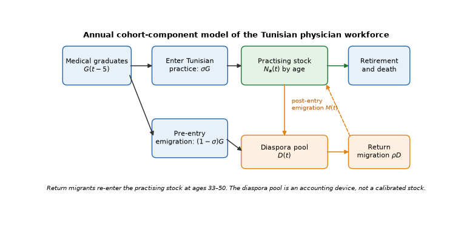

# Additional file 1

## Supplementary tables for: Retention, return or training? A stock-and-flow simulation of Tunisia's physician workforce under incomplete migration data

### Table S1. Model notation

| Symbol | Definition |
|---|---|
| \(N_a(t)\) | Practising physicians aged \(a\) at the start of year \(t\) |
| \(D(t)\) | Effective diaspora pool of Tunisian-trained physicians abroad |
| \(G(t)\) | Medical graduates in year \(t\) |
| \(\sigma(t)\) | Share of graduates entering Tunisian practice |
| \(E(t)\) | Entrants to the practising stock |
| \(X(t)\) | Pre-entry emigration (graduates who never enter Tunisian practice) |
| \(M(t)\) | Post-entry emigration flow |
| \(m(t)\) | Calibrated baseline post-entry emigration flow |
| \(\Pi(t)\) | Scenario/trend multiplier on post-entry emigration |
| \(\rho(t)\) | Annual return rate from the diaspora pool |
| \(R(t)\) | Return migrants entering the practising stock |
| \(r_a\) | Age-specific retirement hazard |
| \(q_a\) | Age-specific mortality/other-exit hazard |
| \(w_a\) | Relative age profile of emigration |
| \(L\) | Postgraduate training lag (5 years) |

### Figure S1. Model flow diagram

### Table S2. Assumed relative age profile of emigration

| Age group | Relative weight \(w_a\) |
|---|---|
| 25–29 | 0.85 |
| 30–34 | 1.00 |
| 35–39 | 0.60 |
| 40–44 | 0.35 |
| 45–49 | 0.20 |
| 50–54 | 0.10 |
| 55–59 | 0.04 |
| 60–64 | 0.02 |
| 65+ | 0.01 |

Weights are relative, not rates. The absolute number of emigrants is set by the calibrated flow \(M(t)\). The profile is varied in sensitivity analysis through a tilt parameter.

### Table S3. Scenario effect sizes: low, central and high

| Scenario | Emigration multiplier (low / central / high) | Reduction in pre-entry emigration (low / central / high) | Return-rate multiplier (low / central / high) | Training multiplier (low / central / high) |
|---|---|---|---|---|
| Business as usual | 1.00 / 1.00 / 1.00 | 0 / 0 / 0 | 1.00 / 1.00 / 1.00 | 1.00 / 1.00 / 1.00 |
| Remuneration and conditions | 0.85 / 0.70 / 0.55 | 15% / 30% / 45% | 1.00 / 1.00 / 1.00 | 1.00 / 1.00 / 1.00 |
| Career development | 0.92 / 0.85 / 0.75 | 8% / 15% / 25% | 1.00 / 1.00 / 1.00 | 1.00 / 1.00 / 1.00 |
| Return migration | 1.00 / 1.00 / 1.00 | 0 / 0 / 0 | 1.35 / 1.75 / 2.50 | 1.00 / 1.00 / 1.00 |
| Training expansion | 1.00 / 1.00 / 1.00 | 0 / 0 / 0 | 1.00 / 1.00 / 1.00 | 1.15 / 1.30 / 1.50 |
| Combined strategy | 0.78 / 0.65 / 0.55 | 22% / 35% / 45% | 1.35 / 1.75 / 2.50 | 1.00 / 1.00 / 1.00 |

### Table S4. Parameter distributions for the Monte Carlo analysis

| Parameter | Distribution | Mean / median | Dispersion | Truncation |
|---|---|---|---|---|
| Pipeline retention, \(\sigma\) | Beta | 0.55 | SD 0.07 | 0–1 |
| Training-output multiplier | Lognormal | 1.00 | log-SD 0.12 | — |
| Return rate, \(\rho\) | Beta | 0.020 | SD 0.008 | 0–1 |
| Emigration age tilt | Lognormal | 1.00 | log-SD 0.15 | — |
| Retirement-age shift | Uniform | 0 | ±1.5 years | — |
| Initial stock, 2008 | Normal | 12,600 | SD 300 | — |
| Calibration residual on \(m\) | Lognormal | 1.00 | log-SD 0.06 | — |

For each draw, the post-entry emigration flow \(m\) is recalibrated to the observed 2024 stock before the projection. All scenarios use the same draw (common random numbers), so scenario differences are not confounded with parameter draws.

### Table S5. Full scenario results: deterministic central estimates and Monte Carlo intervals

| Scenario | Workforce 2040, deterministic | Workforce 2040, median (90% interval) | Physician-years vs BAU, median (90% interval) |
|---|---|---|---|
| Business as usual | 17,987 | 17,794 (16,339–19,968) | — |
| Remuneration and conditions | 21,715 | 21,586 (19,299–24,619) | 29,903 (20,729–41,045) |
| Career development | 19,848 | 19,672 (17,867–22,242) | 14,944 (10,362–20,513) |
| Return migration | 21,433 | 21,061 (18,204–25,344) | 24,828 (11,619–44,698) |
| Training expansion | 19,111 | 18,924 (17,295–21,295) | 3,341 (2,504–4,381) |
| Combined strategy | 25,335 | 25,068 (21,546–30,112) | 56,839 (37,317–85,244) |

### Table S6. Identifiability grid (selected values)

| Pipeline retention \(\sigma\) | Training-output multiplier | RMSE (physicians) | Implied total emigration, 2024 |
|---|---|---|---|
| 0.30 | 0.85 | 272 | 675 |
| 0.55 | 0.85 | 252 | 741 |
| 0.80 | 0.85 | 278 | 807 |
| 0.30 | 1.00 | 285 | 891 |
| 0.55 | 1.00 | 258 | 969 |
| 0.80 | 1.00 | 294 | 1,045 |
| 0.30 | 1.50 | 337 | 1,612 |
| 0.55 | 1.50 | 281 | 1,727 |
| 0.80 | 1.50 | 360 | 1,839 |

The full grid is available in `outputs/tables/identifiability_grid.csv`.

### Table S7. Structural scenarios: annual growth in emigration intensity

| Annual growth in emigration intensity | Workforce 2030 | Workforce 2040 | Density 2040 (/1,000) | Cumulative emigration 2026–2040 |
|---|---|---|---|---|
| 0% (baseline) | 16,041 | 17,987 | 1.42 | 15,811 |
| 3% | 15,390 | 13,574 | 1.07 | 20,835 |
| 5% | 14,917 | 10,003 | 0.79 | 24,921 |
| 7% | 14,413 | 7,592 | 0.60 | 27,852 |

### Table S8. Reporting checklist

The checklist follows the domains of the good practice reporting guideline for health workforce projection models proposed by Lee et al. (Human Resources for Health 2024;22:25).

| Domain | Where addressed |
|---|---|
| Study identification and rationale | Title; Background |
| Model type and scope | Methods, "Model structure" |
| Time horizon and base year | Methods |
| Workforce definition | Methods; Table 1 |
| Data sources and limitations | Table 1; Results, "The emigration level is not identifiable" |
| Model equations and flow diagram | Methods; Table S1; Figure S1 |
| Entry, exit and migration flows | Methods |
| Assumptions and evidence status | Table 2; Table S4 |
| Calibration method | Methods, "Calibration and identifiability" |
| Historical comparison | Results, "Retrospective fit"; Fig. 1 |
| Parameter uncertainty | Methods; Results; Table S5 |
| Structural uncertainty | Methods; Results; Fig. 8; Table S7 |
| Sensitivity analysis | Results, "Sensitivity"; Fig. 6 |
| Scenario definitions | Table 3; Table S3 |
| Results and interpretation | Results; Discussion |
| Generalisability | Discussion |
| Limitations | Strengths and limitations |
| Reproducibility | Declarations; README |
| Ethics and data governance | Declarations |

Items relating to demand–supply gaps and budgetary analysis are not applicable because the model is supply-only. External validation was not possible because no independent validation data exist; the historical comparison is a consistency check.
